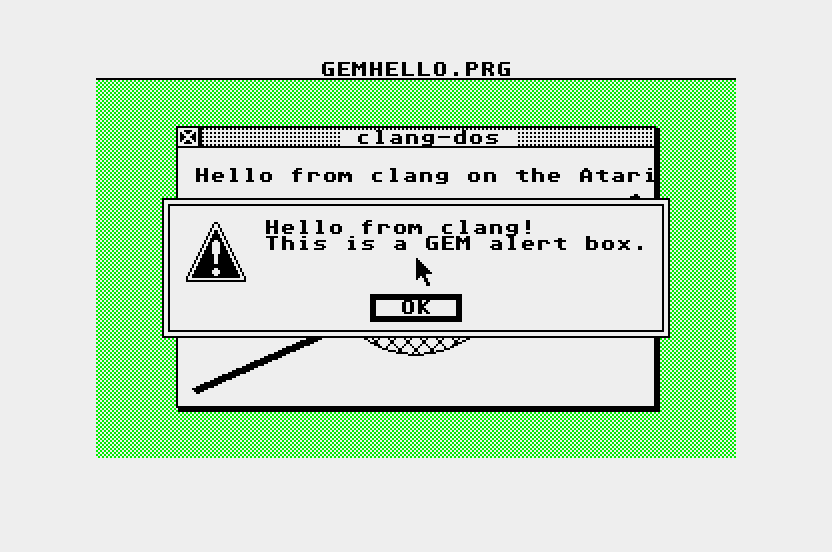

---
hide:
  - navigation
---

# Atari SDK

<!-- include README.md "" -->

```sh
clang --target=m68k-atari-tos -O2 hello.c -o hello.tos
clang --target=m68k-atari-tos -O2 gemhello.c -o gemhello.prg
```

<div class="grid cards" markdown>

-   :material-rocket-launch: **Write programs**

    ---

    [C programs, the ABI and OS calls](using.md): the startup code, memory, files and `<osbind.h>`.

-   :material-window-maximize: **GEM**

    ---

    Windows, menus, dialogs and VDI graphics with [`<gem.h>`](using.md#gem).

-   :material-play-circle: **Run programs**

    ---

    [On EmuTOS in Hatari](running.md), headless, on an emulated ST, STe, TT or Falcon.

-   :material-download: **Get it**

    ---

    The sysroot ships in the [clang-dos toolchain package](https://clang-retro.github.io/dos-sdk/toolchain/), or [build it yourself](building.md).

</div>

<figure markdown>
{ width="720" }
<figcaption>gemhello, a GEM program, on an emulated Atari ST with EmuTOS.</figcaption>
</figure>
